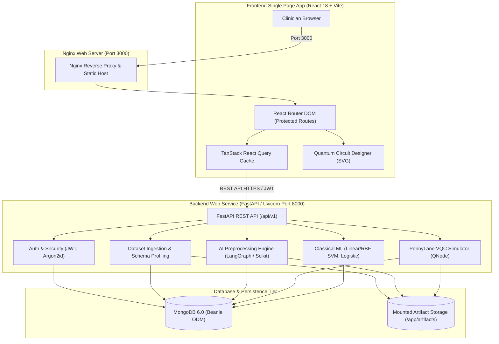
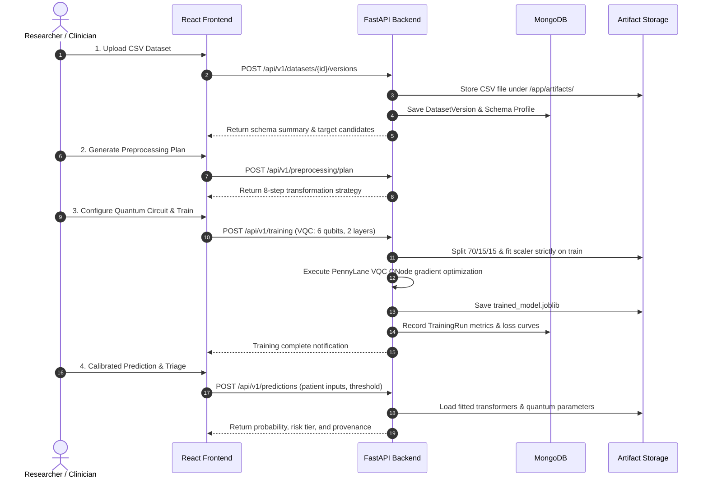

# Diseases Detection Platform — Full-Stack Application

The production web application and clinical workbench for the **Hybrid Quantum Machine Learning Platform for Early Disease Detection**.

The platform provides a complete clinical workflow: tabular dataset ingestion, automated data quality analysis, leakage-free preprocessing with an autonomous AI agent, interactive quantum circuit design, and model training/evaluation benchmarking classical algorithms against Variational Quantum Classifiers (VQC).

---

## Architecture Overview

The application is structured into decoupled frontend, backend, and database tiers orchestrated via Docker Compose:



---

## Directory Structure

```text
Diseases_Detection_Paltform/
├── docker-compose.yml        # Multi-service stack (MongoDB, Redis, MinIO, Backend, Frontend)
├── README.md                 # Platform documentation
├── backend/                  # FastAPI asynchronous backend
│   ├── app/
│   │   ├── api/v1/           # REST endpoints: auth, datasets, prep, training, predictions
│   │   ├── core/             # Configuration, logging, JWT security
│   │   ├── database/models/  # 14 Beanie ODM MongoDB Document models
│   │   ├── ml/               # PennyLane VQC & Scikit-Learn SVM wrappers
│   │   ├── agents/           # Integrated AI Preprocessing Agent
│   │   └── services/         # Dataset, training, prediction, artifact services
│   ├── tests/                # Pytest unit and API integration tests
│   ├── Dockerfile            # Python 3.11 slim container build
│   └── requirements.txt      # Backend Python dependencies
└── frontend/                 # React 18 + Vite + TypeScript frontend
    ├── src/
    │   ├── api/              # Strongly typed Axios API client modules
    │   ├── components/       # CircuitDesigner, PreprocessingPlan, Navigation
    │   ├── context/          # AuthContext for session management
    │   ├── pages/            # Datasets, Preprocessing, Features, Models, Predictions
    │   └── router.tsx        # React Router route configuration
    ├── Dockerfile            # Multi-stage production container build (Node -> Nginx)
    ├── nginx.conf            # Nginx SPA fallback configuration
    └── package.json          # Node dependencies
```

---

## Technology Stack

| Tier | Technology | Purpose |
|---|---|---|
| **Frontend Framework** | React 18.3 + TypeScript | Interactive, type-safe clinical user interface |
| **Frontend Tooling** | Vite 5.3 + Tailwind CSS | Fast development server, CSS utility design tokens |
| **Frontend State** | TanStack React Query 5.50 | Server-state caching and background data synchronization |
| **Backend Framework** | FastAPI 0.111 + Uvicorn | High-concurrency asynchronous RESTful API |
| **Database ODM** | Beanie 1.26 + Motor 3.4 | Async ODM for MongoDB with Pydantic v2 schemas |
| **Database Engine** | MongoDB 6.0 | Document store for dataset versions, training runs, and models |
| **Quantum Computing** | PennyLane 0.38 | Parameterized quantum circuits, statevector & density matrix simulation |
| **Classical ML** | Scikit-learn 1.5 | Classical SVM baselines, SFS feature selection, data transformers |
| **Autonomous Agent** | LangGraph & Scikit-learn | Schema analysis, leakage-free transformation execution |
| **Containerization** | Docker & Docker Compose | Multi-container orchestration and environment isolation |

---

## Implemented Workflows



---

## Quick Start (Docker Compose)

### 1. Prerequisites
- Docker Engine 24.0+
- Docker Compose v2.0+

### 2. Launch Stack
From this directory:
```bash
docker compose up --build -d
```

### 3. Verify Containers
```bash
docker compose ps
```

### 4. Service Endpoints
| Service | URL | Credentials |
|---|---|---|
| **Web Dashboard** | [http://localhost:3000](http://localhost:3000) | `hqml@gmail.com` / `12345678` |
| **FastAPI Swagger Docs** | [http://localhost:8000/api/v1/docs](http://localhost:8000/api/v1/docs) | N/A |
| **API Health Probe** | [http://localhost:8000/api/v1/health](http://localhost:8000/api/v1/health) | N/A |
| **MinIO Console** | [http://localhost:9001](http://localhost:9001) | `minioadmin` / `minioadmin` |
| **MongoDB** | `localhost:27017` | Standard connection |

To stop the platform:
```bash
docker compose down
```

---

## Local Development (Without Docker)

### Backend Setup
```bash
cd backend
python -m venv .venv
# On Windows: .venv\Scripts\Activate.ps1 | On Unix: source .venv/bin/activate
pip install -r requirements.txt
cp .env.example .env
uvicorn app.main:app --reload --host 0.0.0.0 --port 8000
```

### Frontend Setup
```bash
cd frontend
npm install
cp .env.example .env
npm run dev
```

---

## Troubleshooting & Verification

- **Large Dataset Upload Failures (413 Request Entity Too Large):** Nginx has been configured with `client_max_body_size 100M;` and Axios client timeout is set to 5 minutes (`300,000ms`). Ensure Docker has sufficient memory allocated.
- **Vite Proxy in Docker:** Ensure `VITE_API_BASE_URL` is set to `http://localhost:8000/api/v1` (or your public backend URL) during frontend production builds.
