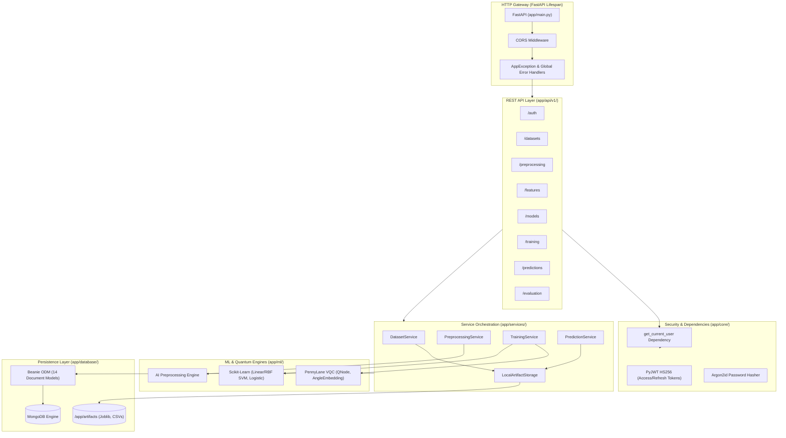

# Backend Service — FastAPI & Beanie ODM Architecture

The backend for the **Hybrid QML Disease Detection Platform** is a high-performance, asynchronous REST service built with **FastAPI** and **Python 3.11**. It manages biomedical dataset ingestion, automated data preprocessing, classical machine learning pipelines, and PennyLane quantum circuit simulation.

---

## Architectural Highlights

- **Framework**: FastAPI (>=0.111.0) on Uvicorn ASGI server with uvloop event loops.
- **Database**: MongoDB 6.0/7.0 via Motor asynchronous driver and Beanie Object-Document Mapper (ODM) with Pydantic v2 validation.
- **Authentication**: Stateless HS256 JWT Bearer tokens with memory-hard Argon2id password hashing (`argon2-cffi`).
- **Quantum Engine**: PennyLane 0.38+ with parameterized QNodes running on pure statevector (`default.qubit`) and open-system density matrix (`default.mixed`) simulator devices.
- **Artifact Handling**: `LocalArtifactStorage` with strict canonical path traversal validation (`_resolve_safe_path()`) saving files under `ARTIFACT_ROOT` (`/app/artifacts`).

---

## Backend Subsystem Architecture



---

## Directory Structure

```text
backend/
├── app/
│   ├── main.py                # Application entrypoint, lifespan, CORS, Beanie initialization
│   ├── core/                  # Configuration, logging, JWT, and Argon2id security
│   ├── api/                   # REST routing
│   │   └── v1/                # Version 1 route endpoints (auth, datasets, training, etc.)
│   ├── database/              # MongoDB connection & 14 Beanie ODM models
│   │   └── models/            # User, Dataset, DatasetVersion, TrainingRun, Model, etc.
│   ├── interfaces/            # Abstract base classes and protocol contracts
│   ├── ml/                    # Quantum (VQC) and classical (SVM) model wrappers
│   ├── agents/                # Integrated AI Preprocessing Agent & deterministic tools
│   ├── services/              # Business logic (dataset, training, prediction, artifact services)
│   └── workers/               # Background task definitions
├── tests/                     # Pytest suite
│   ├── api/                   # Route integration tests (auth, datasets, multi-tenant isolation)
│   └── unit/                  # Unit tests (path traversal security, preprocessing tools)
├── Dockerfile                 # Python 3.11 slim production container configuration
├── requirements.txt           # Python package dependencies
└── .env.example               # Starter environment variable template
```

---

## Database Models (Beanie ODM)

All document schemas inherit from `beanie.Document` with Pydantic v2 validation:

| Collection / Model | Purpose | Primary Fields |
|---|---|---|
| `User` | User account identity | `email` (Indexed, unique), `password_hash`, `role`, `created_at` |
| `Dataset` | High-level dataset container | `user_id` (Indexed), `name`, `disease_type`, `description` |
| `DatasetVersion` | Immutable version of a dataset | `dataset_id`, `version_tag`, `row_count`, `column_count`, `storage_path` |
| `PreprocessingRun` | Preprocessing execution log | `dataset_version_id`, `plan`, `operations_log`, `status` |
| `PreprocessingArtifact`| Transformed data partitions | `preprocessing_run_id`, `split_type` (train/val/test), `file_path` |
| `FeatureSelectionRun`| Feature importance record | `dataset_version_id`, `method`, `selected_features`, `scores` |
| `Model` | Trained or default model metadata | `name`, `model_type` (VQC, SVM), `qubit_count`, `artifact_path` |
| `TrainingRun` | Training run telemetry | `user_id`, `model_id`, `epochs`, `loss_curve`, `evaluation_metrics` |
| `Prediction` | Inference record | `model_id`, `input_features`, `probability`, `risk_level` |
| `PredictionFeedback` | Clinician validation feedback | `prediction_id`, `true_label`, `clinician_notes` |
| `Experiment` | Multi-run benchmark group | `user_id`, `name`, `model_ids`, `comparison_matrix` |
| `AuditLog` | Security and access audit record | `user_id`, `action`, `resource_type`, `timestamp` |

---

## API Documentation (`/api/v1`)

| Method | Route | Description | Auth Required |
|---|---|---|:---:|
| `POST` | `/auth/register` | Register new clinician account | No |
| `POST` | `/auth/login` | Login and receive Bearer JWT | No |
| `POST` | `/auth/refresh` | Issue new access token using refresh token | No |
| `GET` | `/auth/me` | Fetch active user profile | Yes |
| `GET` | `/datasets` | List datasets owned by active user | Yes |
| `POST` | `/datasets` | Create a dataset container | Yes |
| `POST` | `/datasets/{id}/versions` | Upload a tabular CSV file | Yes |
| `GET` | `/datasets/{id}/versions/{v_id}/analysis` | Get schema profiling and quality metrics | Yes |
| `POST` | `/preprocessing/plan` | Generate AI or heuristic preprocessing plan | Yes |
| `POST` | `/preprocessing/execute` | Execute deterministic transformations on data | Yes |
| `POST` | `/preprocessing/ai/modify` | Natural-language modification of plan steps | Yes |
| `POST` | `/features/select` | Run feature importance ranking (Mutual Info, SFS) | Yes |
| `GET` | `/models` | List available models, trained estimators, and zoo | Yes |
| `POST` | `/models/compare` | Compare metrics of two or more models | Yes |
| `POST` | `/training` | Dispatch a model training run | Yes |
| `GET` | `/training/{run_id}` | Poll real-time training status and loss curves | Yes |
| `POST` | `/predictions` | Run calibrated inference on submitted features | Yes |
| `GET` | `/quantum/devices` | Query available quantum simulator devices | Yes |
| `GET` | `/health` | Liveness health probe | No |

---

## Environment Configuration

Create a `.env` file in this directory based on `.env.example`:

```env
# Application Runtime
ENVIRONMENT=development
LOG_LEVEL=INFO
HOST=0.0.0.0
PORT=8000

# MongoDB Database Configuration
MONGODB_URL=mongodb://localhost:27017
MONGODB_DB=hybrid_qml_db

# Security & Authentication
JWT_SECRET=super_secret_jwt_key_change_in_production
JWT_ALGORITHM=HS256
ACCESS_TOKEN_EXPIRE_MINUTES=60
REFRESH_TOKEN_EXPIRE_DAYS=7

# Local Storage
ARTIFACT_ROOT=/app/artifacts
CORS_ORIGINS=http://localhost:3000,http://localhost:5173

# Background Tasks & Workers
REDIS_URL=redis://localhost:6379/0

# LLM Preprocessing Engine
LLM_PROVIDER=ollama
LLM_BASE_URL=http://localhost:11434
```

---

## Local Development & Testing

### 1. Setup Virtual Environment
```bash
python -m venv .venv
# On Windows:
.\.venv\Scripts\Activate.ps1
# On Unix:
source .venv/bin/activate

pip install -r requirements.txt
```

### 2. Run Database
Ensure a local MongoDB container is running:
```bash
docker run -d --name local-mongo -p 27017:27017 mongo:6.0
```

### 3. Run FastAPI Application
```bash
uvicorn app.main:app --reload --host 0.0.0.0 --port 8000
```
Open Swagger UI at `http://localhost:8000/api/v1/docs`.

### 4. Execute Test Suite
```bash
python -m pytest tests/ -v
```
Tests include:
- `tests/api/test_auth.py`: Registration, login, token refresh, invalid credentials.
- `tests/api/test_datasets.py`: Upload, schema analysis, multi-user isolation verification.
- `tests/api/test_preprocessing.py`: Plan generation, transformation pipeline, execution integrity.
- `tests/unit/test_artifact_security.py`: Canonical path resolution and directory traversal protections.
