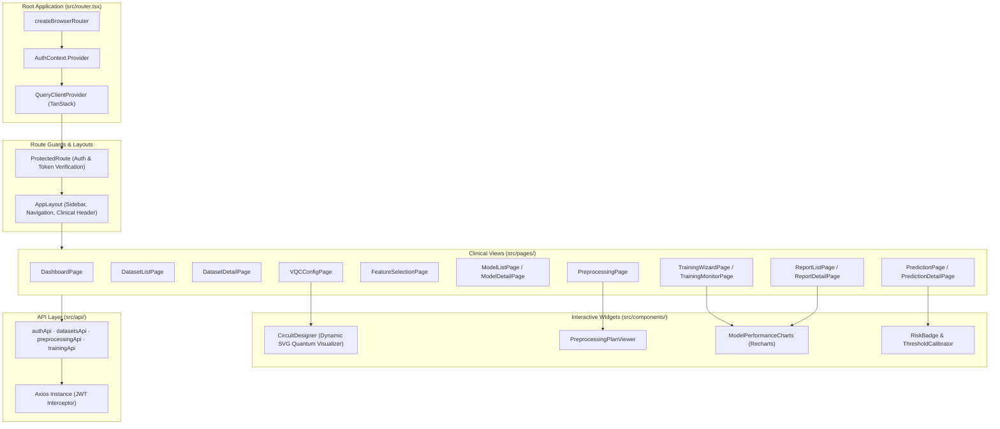

# Frontend UI — React 18, Vite & TypeScript Workbench

The frontend application for the **Hybrid QML Disease Detection Platform** provides clinicians, researchers, and data scientists with an interactive single-page application (SPA) to manage biomedical datasets, configure quantum-classical training runs, visualize quantum circuits, and perform calibrated risk predictions.

---

## Architecture & Tech Stack

- **Core Framework**: React 18.3.1
- **Language**: TypeScript 5.5.3 (strict type checking enabled)
- **Build Tool**: Vite 5.3.3 (fast HMR and optimized tree-shaking)
- **Styling**: Tailwind CSS 3.4.4 with custom clinical and quantum color tokens
- **Server State**: `@tanstack/react-query` 5.50.0 (query caching, background synchronization)
- **Client Session**: React Context (`AuthContext.tsx`) syncing tokens to `localStorage`
- **Routing**: React Router DOM 6.24.1 (`createBrowserRouter` with protected layout routes)
- **API Client**: Axios 1.7.2 with automatic Bearer JWT injection and 401 redirect interceptors
- **Data Visualization**: Recharts 2.12.7 (loss histories, ROC curves, confusion matrices)
- **Icons**: Lucide React 0.396.0

---

## Client Component Architecture



---

## Directory Structure

```text
frontend/
├── Dockerfile                 # Multi-stage production container build (Node -> Nginx)
├── nginx.conf                 # Nginx web server configuration with SPA routing fallback
├── package.json               # Node packages and build scripts
├── postcss.config.js          # PostCSS configuration
├── tailwind.config.js         # Custom medical and quantum design tokens
├── tsconfig.json              # TypeScript compilation configuration
├── vite.config.ts             # Vite development server and bundling settings
└── src/
    ├── api/                   # API client layer
    │   ├── client.ts          # Central Axios instance with JWT interceptors
    │   └── index.ts           # Strongly typed domain modules (auth, datasets, training)
    ├── components/            # Reusable UI components
    │   ├── layout/            # Sidebar, Header, ProtectedRoute
    │   └── vqc/               # CircuitDesigner (SVG quantum circuit visualizer)
    ├── context/               # Global contexts
    │   └── AuthContext.tsx    # User session, JWT persistence, login/logout handlers
    ├── pages/                 # Full view components
    │   ├── auth/              # LoginPage, RegisterPage
    │   ├── datasets/          # Dataset upload, schema profiling, distributions
    │   ├── preprocessing/     # 7-stage guided preprocessing wizard
    │   ├── features/          # Feature importance ranking and selection
    │   ├── models/            # Model zoo, checkpoint catalog, VQC designer
    │   ├── training/          # Training wizard and real-time loss monitor
    │   ├── predictions/       # Prediction form, threshold tuning, risk badges
    │   └── reports/           # Comparison matrix, print/PDF report exporter
    ├── router.tsx             # React Router route hierarchy
    ├── main.tsx               # Application mount point
    └── index.css              # Tailwind CSS imports and utility layer styles
```

---

## Key Page Workflows

### 1. Dynamic Quantum Circuit Designer (`VQCConfigPage.tsx`)
- Allows users to configure quantum registers from 2 to 24 qubits and 1 to 10 variational layers.
- Selects data encoding strategy ($R_y$ Angle Embedding, $R_x$), variational rotational gate, and entangling strategy (linear nearest-neighbor vs. ring closure).
- **`CircuitDesigner.tsx`** renders a real-time SVG schematic showing qubit wires, data loading gates, parameterized rotations, and CNOT ladders, displaying calculated circuit depth and parameter count.

### 2. Guided 7-Stage Preprocessing Pipeline (`PreprocessingPage.tsx`)
- **Stage 1 (Cohort Selection):** Select an active dataset version.
- **Stage 2 (Quality Profiling):** Review missing value rates, category casing, and outlier counts.
- **Stage 3 (Plan Generation):** Review the 8-step transformation plan suggested by the AI agent.
- **Stage 4 (Plan Customization):** Modify specific steps or instruct the AI via natural language.
- **Stage 5 (Execution):** Execute deterministic transformations with strict train-fit isolation.
- **Stage 6 (Validation Audit):** Review 7-point integrity checklist (zero missing, target exclusion).
- **Stage 7 (Artifact Creation):** Inspect final transformed partitions and download serializable Joblib pipelines.

### 3. Calibrated Risk Inference & Triage (`PredictionPage.tsx`)
- Dynamically generates input fields based on the model's selected features.
- Enables clinicians to adjust the classification threshold $\tau \in [0.1, 0.9]$.
- Computes risk categories:
  - **LOW RISK:** Probability $< 35\%$
  - **MEDIUM RISK:** Probability between $35\%$ and $65\%$
  - **HIGH RISK:** Probability $> 65\%$
- Displays pipeline provenance: dataset version ID, model checkpoint SHA, and fitted transformer IDs.

---

## Environment Configuration

Create a `.env` file in `frontend/` for local development:

```env
# Backend API Base URL
VITE_API_BASE_URL=http://localhost:8000/api/v1
```

---

## Local Development & Build

### 1. Install Dependencies
```bash
npm install
```

### 2. Start Vite Development Server
```bash
npm run dev
```
Open `http://localhost:5173` (or `http://localhost:3000`).

### 3. Build Production Bundle
```bash
npm run build
```
Compiled static assets are generated in `frontend/dist/`.

### 4. Build & Run Docker Container
```bash
docker build -t hybrid_qml_frontend .
docker run -p 3000:80 -e VITE_API_BASE_URL=http://localhost:8000/api/v1 hybrid_qml_frontend
```
The production image utilizes `nginx:alpine` to serve static assets with client-side SPA routing fallback configured in `nginx.conf`.
