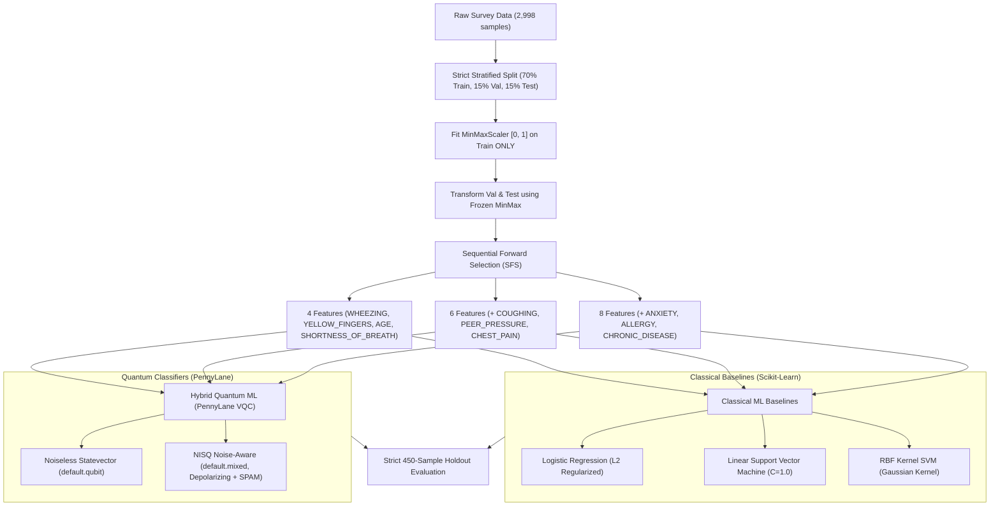

# Experimental Machine Learning for Lung Cancer Detection

**Research & Algorithmic Benchmarks**  
*Project: Hybrid Quantum-Classical Machine Learning Platform for Early Disease Detection*  
*Disease Focus: Non-Small Cell Lung Carcinoma & Survey Indicator Screening*

---

## 1. Purpose & Research Scope

This directory contains the experimental research suite investigating whether low-depth **Variational Quantum Classifiers (VQCs)** running on compact qubit registers ($n \in [4, 8]$) can capture non-linear interactions among clinical survey predictors and improve clinical sensitivity (recall) relative to standard classical baselines.

> [!NOTE]  
> All models, findings, and evaluation metrics in this module are research prototypes evaluated on the **Survey Lung Cancer Dataset** (`data/raw/V1_dataset.csv`). This work is an academic algorithmic study and does not constitute a certified medical device.

---

## 2. Dataset Context

All experiments operate on the standardized **Survey Lung Cancer Dataset**:
- **Dataset Path**: `data/raw/V1_dataset.csv`
- **Total Records**: 2,998 survey observations (0 missing values, 2 duplicates removed)
- **Target Variable**: `LUNG_CANCER` (0 = Negative / No Cancer, 1 = Positive / Cancer)
- **Class Balance**: 1,518 Positive (50.60%) vs. 1,482 Negative (49.40%)
- **Clinical Attributes (15 candidate predictors)**:
  - *Demographic:* `GENDER`, `AGE` (range 21–87, mean $62.7 \pm 8.2$)
  - *Behavioral:* `SMOKING`, `ALCOHOL_CONSUMING`, `PEER_PRESSURE`
  - *Symptoms:* `YELLOW_FINGERS`, `ANXIETY`, `CHRONIC_DISEASE`, `FATIGUE`, `ALLERGY`, `WHEEZING`, `COUGHING`, `SHORTNESS_OF_BREATH`, `SWALLOWING_DIFFICULTY`, `CHEST_PAIN`
- **Strict Partitioning**:
  - Training Partition: 2,098 samples (70%)
  - Validation Partition: 450 samples (15%)
  - Held-out Test Partition: 450 samples (15%: 227 positive, 223 negative; held out strictly until final evaluation)

---

## 3. Experimental Architecture & Workflow



---

## 4. Variational Quantum Classifier (VQC) Circuit Specification

The Variational Quantum Classifiers map tabular feature vectors into high-dimensional quantum Hilbert state spaces using PennyLane:

```
|0⟩ ──[ RY(x₀·π) ]──[ RY(θ₁,₀) ]──╭●─────────────[ RY(θ₂,₀) ]──╭●─────────────┤ ⟨Z₀⟩ ──╮
|0⟩ ──[ RY(x₁·π) ]──[ RY(θ₁,₁) ]──╰X─╭●──────────[ RY(θ₂,₁) ]──╰X─╭●──────────┤ ⟨Z₁⟩ ──┤
|0⟩ ──[ RY(x₂·π) ]──[ RY(θ₁,₂) ]─────╰X─╭●───────[ RY(θ₂,₂) ]─────╰X─╭●───────┤ ⟨Z₂⟩ ──┼─► Mean ⟨Z⟩ ──► [+ b] ──► σ(·) ──► p(y=1)
|0⟩ ──[ RY(x₃·π) ]──[ RY(θ₁,₃) ]────────╰X─╭●────[ RY(θ₂,₃) ]────────╰X─╭●────┤ ⟨Z₃⟩ ──┤
                                         ...                              ...    ...     │
|0⟩ ──[ RY(xₙ·π) ]──[ RY(θ₁,ₙ) ]───────────╰X────[ RY(θ₂,ₙ) ]───────────╰X────┤ ⟨Zₙ⟩ ──╯
      └─────────┘   └────────────────────────┘   └────────────────────────┘   └───────┘
        Stage 1:              Stage 2:                     Stage 3:            Stage 4:
       Data Encoding       Variational Layer 1          Variational Layer 2   Measurement
```

### Mathematical Formulation
1. **Y-Axis Angle Embedding:** Normalized feature vector $\mathbf{x} \in [0, 1]^n$ is mapped onto single-qubit rotations:
   $$|\psi_0(\mathbf{x})\rangle = \bigotimes_{i=0}^{n-1} \hat{R}_y(x_i \cdot \pi) |0\rangle = \bigotimes_{i=0}^{n-1} \left[ \cos\left(\frac{x_i \pi}{2}\right)|0\rangle + \sin\left(\frac{x_i \pi}{2}\right)|1\rangle \right]$$
2. **Parameterized Variational Layers:** $L = 2$ layers combining single-qubit rotations $U_{\text{rot}}(\boldsymbol{\theta}_l) = \bigotimes_{i=0}^{n-1} \hat{R}_y(\theta_{l, i})$ and nearest-neighbor linear CNOT ladders.
3. **Pauli-Z Expectation Pooling:**
   $$\langle Z \rangle = \frac{1}{n} \sum_{i=0}^{n-1} \langle Z_i \rangle$$
4. **Calibrated Sigmoid Head:**
   $$\hat{p} = \sigma(\langle Z \rangle + b) = \frac{1}{1 + \exp(-(\langle Z \rangle + b))}$$
5. **Parameter Complexity:** Trainable parameters $= n_{\text{qubits}} \times L_{\text{layers}} + 1_{\text{bias}}$.
   - 4-qubit VQC: $4 \times 2 + 1 = 9$ parameters
   - 6-qubit VQC: $6 \times 2 + 1 = 13$ parameters
   - 8-qubit VQC: $8 \times 2 + 1 = 17$ parameters

---

## 5. Master Comparative Benchmarks

Evaluation metrics computed on the strictly held-out test partition (**450 patient records: 227 positive, 223 negative**):

| Model Name | Category | Features | Qubits | Params | Accuracy | Balanced Acc. | Sensitivity (Recall) | Specificity | Precision | F1-Score | ROC-AUC | False Pos (FP) | False Neg (FN) |
|---|---|---:|---:|---:|---:|---:|---:|---:|---:|---:|---:|---:|---:|
| **6-Qubit Noiseless VQC** | **Hybrid QML** | **6** | **6** | **13** | 53.11% | 52.92% | **74.45% (Peak)** | 31.39% | 52.48% | **61.57%** | **0.5555** | 153 | **58** |
| **Logistic Regression (6 Feats)** | Classical ML | 6 | 0 | 7 | 54.00% | 53.87% | 68.28% | 39.46% | 53.45% | 59.96% | 0.5531 | 135 | 72 |
| **Classical RBF SVM (6 Feats)** | Classical ML | 6 | 0 | Non-param | **54.67%** | **54.61%** | 60.79% | 48.43% | **54.55%** | 57.50% | 0.5316 | 115 | 89 |
| **4-Qubit Noiseless VQC** | Hybrid QML | 4 | 4 | **9** | 52.67% | 52.69% | 49.78% | 55.61% | 53.30% | 51.48% | 0.5147 | 99 | 114 |
| **4-Qubit Noisy VQC (NISQ)** | **Hybrid QML** | **4** | **4** | **9** | 52.67% | 52.70% | 49.34% | **56.05%** | 53.33% | 51.26% | 0.5174 | **98** | 115 |
| **Classical RBF SVM (4 Feats)** | Classical ML | 4 | 0 | Non-param | 52.44% | 52.46% | 51.10% | 53.81% | 52.97% | 52.02% | 0.5318 | 103 | 111 |
| **Logistic Regression (4 Feats)** | Classical ML | 4 | 0 | 5 | 51.78% | 51.72% | 58.15% | 45.29% | 51.97% | 54.89% | 0.5256 | 122 | 95 |
| **8-Qubit Noiseless VQC** | Hybrid QML | 8 | 8 | **17** | 48.44% | 48.50% | 42.73% | 54.26% | 48.74% | 45.54% | 0.4990 | 102 | 130 |
| **Classical Linear SVM (6 Feats)** | Classical ML | 6 | 0 | 7 | 50.44% | 50.00% | 100.00%* | 0.00%* | 50.44% | 67.06% | 0.4541 | 223 | **0** |
| **Classical Linear SVM (8 Feats)** | Classical ML | 8 | 0 | 9 | 50.44% | 50.00% | 100.00%* | 0.00%* | 50.44% | 67.06% | 0.5065 | 223 | **0** |

---

## 6. Key Scientific Findings

### 1. Classical Margin Collapse under Collinear Survey Noise
When expanding from 4 features to 6 and 8 features, classical Linear SVMs suffered catastrophic boundary collapse: they predicted 100% positive, resulting in $100.0\%$ sensitivity, $0.0\%$ specificity, and $223$ false positives. The high collinearity among symptoms compressed the margin between classes, pushing linear hyperplanes completely outside the negative cluster.

### 2. Quantum Expressibility & Peak Clinical Sensitivity
The **6-Qubit Noiseless VQC achieved the highest clinical sensitivity in the study: 74.45%** (missing only 58 positive cases vs. 89 missed by RBF SVM and 72 missed by Logistic Regression). It accomplished this using **only 13 trainable parameters**, demonstrating that compact quantum Hilbert spaces can construct complex non-linear decision regions with extreme parameter economy.

### 3. Intrinsic Structural Noise Resilience
Simulating physical NISQ noise on the 4-qubit VQC (depolarizing Kraus channels and SPAM readout bit-flip noise on `default.mixed`) resulted in virtually identical test metrics ($52.67\%$ accuracy and $0.5174$ vs. $0.5147$ AUC). The shallow circuit depth ($L=2$, 6 CNOTs) prevented coherent error accumulation.

### 4. The 8-Qubit Plateau (Dimensionality Degeneracy)
Expanding to 8 qubits degraded test accuracy to $48.44\%$ and sensitivity to $42.73\%$. Moving to a $2^8 = 256$ dimensional Hilbert space without an exponential increase in training data induces gradient diffusion (barren plateaus). **Takeaway: In NISQ computing, feature selection budgeting strictly outperforms blind qubit scaling.**

---

## 7. Directory Structure & Research Artifacts

```text
Experimental_ML/Lung_Cancer/
├── CML/                       # Classical Machine Learning code and checkpoints
│   ├── 4-feature/             # Logistic, Linear SVM, RBF SVM (4 features)
│   ├── 6-feature/             # Classical models (6 features)
│   └── 8-feature/             # Classical models (8 features)
├── HQML/                      # Hybrid Quantum Machine Learning implementations
│   ├── 4-feature-VQC/         # 4-qubit noiseless VQC (PennyLane default.qubit)
│   ├── 4-feature-VQC-Noisy/   # 4-qubit noisy VQC (default.mixed density matrix)
│   ├── 6-feature-VQC/         # 6-qubit noiseless VQC (Peak sensitivity model)
│   └── 8-feature-VQC/         # 8-qubit noiseless VQC (Dimensionality study)
├── data/                      # Raw and processed datasets
│   ├── raw/V1_dataset.csv     # Survey Lung Cancer dataset (2,998 rows)
│   └── processed/             # Partitioned splits and selected_features.json
├── notebooks/                 # Exploratory research notebooks
│   ├── 01_dataset_analysis.ipynb
│   ├── 02_preprocessing_and_split.ipynb
│   ├── 03_feature_engineering_selection.ipynb
│   ├── 04_train_cml_baselines.ipynb
│   ├── 05_train_vqc.ipynb
│   ├── 06_train_vqc_noisy.ipynb
│   └── 07_model_comparison.ipynb
├── results/                   # Evaluation figures, confusion matrices, metrics JSONs
│   └── classical_vs_quantum/  # model_comparison_metrics.json
└── docs/                      # 11 In-depth scientific research monographs
```
