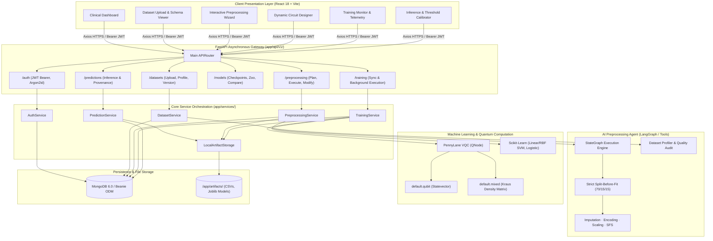
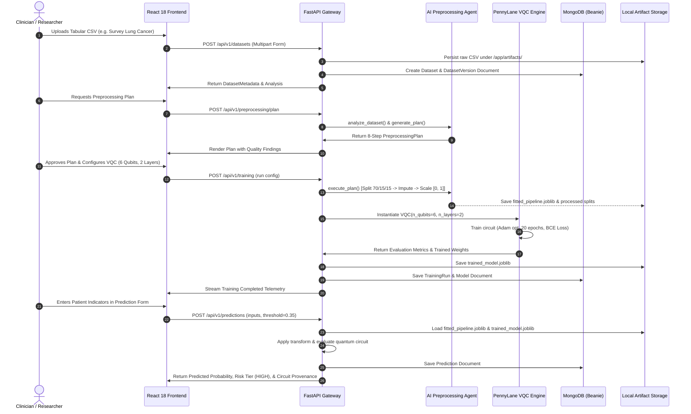
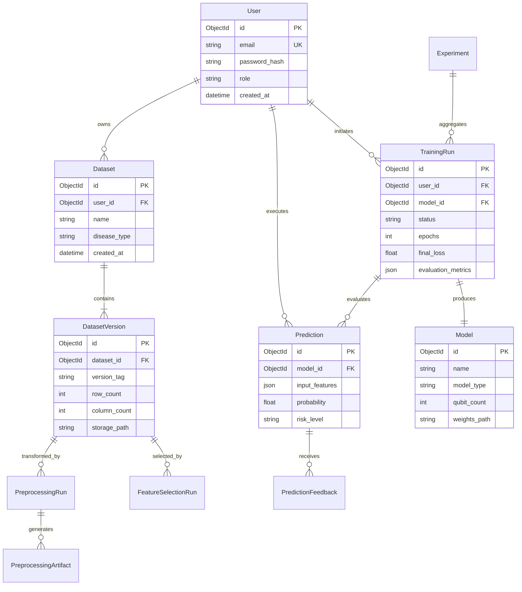
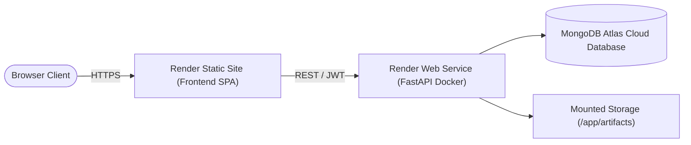

# Hybrid QML Disease Detection Platform

An enterprise-grade, hybrid quantum-classical machine learning platform and clinical diagnostic workbench for early disease screening from tabular biomedical datasets. 

The system couples **autonomous LLM data preprocessing** with **Variational Quantum Classifiers (VQC)** using PennyLane and classical machine learning baselines (SVMs, Logistic Regression). It supports pure statevector quantum simulation, noise-aware open-system NISQ evaluation, and an interactive clinical workbench for threshold-calibrated risk stratification.

---

### 📑 Project Documentation & Executive Downloads
- **One-Page Project Description (PDF):** [One_Page_Project_Description.pdf](One_Page_Project_Description.pdf) — Concise executive summary of purpose, 4-pillar architecture, empirical benchmarks, and tech stack *(Verified strictly 1 page)*.
- **Complete Codebase Showcase (PDF):** [Project_Code_Showcase.pdf](Project_Code_Showcase.pdf) — In-depth 9-page technical document showcasing code implementations across QML, Classical ML, AI Preprocessing, FastAPI/Beanie backend, and React/TypeScript frontend.

---

### 🌐 Live Prototype & Cloud Deployment
- **Live Frontend Application:** [https://disease-detection-frontend-eqao.onrender.com/](https://disease-detection-frontend-eqao.onrender.com/)
- **Live Backend API (Swagger):** [https://disease-detection-backend-asag.onrender.com/api/v1/docs](https://disease-detection-backend-asag.onrender.com/api/v1/docs)
- **Default Clinical Demo Account:** `hqml@gmail.com` | **Password:** `12345678`

> [!NOTE]  
> The public demo is hosted on Render's free container tier (512MB RAM). High-qubit quantum simulation or simultaneous training runs should be executed locally using Docker Compose to prevent container memory limits.

---

## Table of Contents
1. [Project Overview](#project-overview)
2. [Problem Statement](#problem-statement)
3. [Solution](#solution)
4. [Key Features](#key-features)
5. [System Architecture](#system-architecture)
   - [Complete Architecture Diagram](#complete-architecture-diagram)
   - [Subsystem Architecture](#subsystem-architecture)
   - [Data Flow & Sequence Diagram](#data-flow--sequence-diagram)
6. [Technology Stack](#technology-stack)
7. [Project Directory Structure](#project-directory-structure)
8. [Core Modules](#core-modules)
9. [Quantum Machine Learning Architecture](#quantum-machine-learning-architecture)
10. [Autonomous AI Preprocessing Agent](#autonomous-ai-preprocessing-agent)
11. [Database Architecture](#database-architecture)
12. [API Documentation](#api-documentation)
13. [Empirical Benchmarks & Validation](#empirical-benchmarks--validation)
14. [Installation and Setup](#installation-and-setup)
15. [Environment Variables](#environment-variables)
16. [Running the Application](#running-the-application)
17. [Docker & Container Orchestration](#docker--container-orchestration)
18. [Deployment Architecture](#deployment-architecture)
19. [Security and Reliability](#security-and-reliability)
20. [Testing & Quality Assurance](#testing--quality-assurance)
21. [Limitations & Known Trade-offs](#limitations--known-trade-offs)
22. [Future Enhancements](#future-enhancements)
23. [Contribution Guidelines](#contribution-guidelines)
24. [License](#license)
25. [Acknowledgements](#acknowledgements)

---

## 1. Project Overview

The **Hybrid QML Disease Detection Platform** bridges advanced quantum computational theory and applied healthcare data engineering. Tabular biomedical datasets—such as clinical symptom surveys, physiological records, and cardiac indicators—exhibit extreme feature collinearity, low signal-to-noise ratios, and complex non-linear interactions.

This platform implements:
- An **Autonomous Preprocessing Agent** engineered with LangGraph to automate data quality profiling, missingness imputation, categorical encoding, and feature scaling with a mathematical guarantee against validation data leakage.
- A **Variational Quantum Classifier (VQC)** engine implemented in PennyLane that maps normalized clinical vectors into high-dimensional quantum Hilbert spaces via Y-axis Angle Embedding ($R_y$) and parameterized entangling circuits.
- A **Full-Stack Clinical Workbench** comprising a FastAPI backend, MongoDB (Beanie ODM), and a responsive React 18 + Vite SPA featuring an interactive Quantum Circuit Designer, operational threshold tuner, and model comparison suite.

---

## 2. Problem Statement

Early screening for asymptomatic conditions—such as non-small-cell lung cancer and cardiovascular disease—faces three critical bottlenecks:
1. **Classical Margin Collapse under High Collinearity:** When features exhibit high inter-correlation (e.g., coughing, wheezing, and shortness of breath in survey data), classical linear classifiers like Support Vector Machines (SVM) frequently experience hyperplane margin collapse. They classify 100% of samples into the majority class, producing $0\%$ specificity and rendering the system diagnostically useless.
2. **Data Leakage in Biomedical Pipelines:** Traditional data preparation frequently computes scaling, imputation, and outlier statistics across the entire dataset prior to splitting. This subtly contaminates validation partitions with test distributions, producing artificially inflated metrics that fail in clinical practice.
3. **Qubit and Expressibility Constraints in NISQ Hardware:** Current Noisy Intermediate-Scale Quantum (NISQ) processors cannot execute deep circuits or accommodate large feature sets without severe decoherence and barren plateaus. Algorithmic architectures must enforce strict feature budgeting and low-depth entangling topologies.

---

## 3. Solution

The platform resolves these challenges through an integrated, multi-tier pipeline:

```
[Raw Tabular Dataset] ➔ [AI Schema Profiler] ➔ [Leakage-Free Preprocessing]
          │
          ├──► [Classical Baselines: Linear SVM / RBF SVM / Logistic Regression]
          │
          └──► [Quantum Pipeline: Angle Embedding Ry(xi·π) + 2-Layer VQC]
                    │
                    ▼
          [Strict 450-Sample Holdout Evaluation] ➔ [Calibrated Risk Inference]
```

1. **Deterministic "Split-Before-Fit" Engineering:** The preprocessing subsystem splits data into stratified 70% Train, 15% Validation, and 15% Holdout Test partitions *before* computing any statistics. Imputers, scalers, and encoders fit strictly on `X_train` and freeze parameters for subsequent partitions.
2. **Angle Embedding & Low-Depth VQC:** Features are normalized to $[0, 1]$ and mapped to single-qubit rotations $R_y(x_i \cdot \pi)$. A parameterized ansatz ($L=2$ layers) uses nearest-neighbor CNOT ladders, achieving non-linear separability with as few as **13 trainable parameters** for a 6-qubit system.
3. **Dual Simulation Formalism:** The quantum engine benchmarks pure statevector calculations (`default.qubit`) against open-system density matrix models (`default.mixed`) subject to depolarizing, phase-damping, and readout bit-flip noise channels.
4. **Clinical Triage Thresholding:** Predictions produce calibrated probabilities $\hat{p} \in [0, 1]$ mapped across user-adjustable decision thresholds ($\tau \in [0.1, 0.9]$), enabling clinicians to prioritize recall ($>85\%$) for preliminary screening.

---

## 4. Key Features

| Category | Feature | Implementation Details |
|---|---|---|
| **Data Ingestion** | **Dynamic Schema Profiling** | Detects numerical, discrete survey, and categorical types; flags missing values, outliers, constant features, and multicollinearity. |
| **Data Engineering** | **Autonomous AI Agent** | Evaluates data quality, designs an 8-point preprocessing strategy, and executes scikit-learn transformations with 7-point validation integrity checks. |
| **Quantum ML** | **Variational Quantum Classifier** | Parameterized PennyLane circuit with Y-axis Angle Embedding, parameterized $R_y(\theta)$ layers, and linear/ring CNOT entanglement. |
| **Quantum ML** | **Noise-Aware Simulation** | Models physical NISQ decoherence via Kraus operators: single-qubit depolarizing ($p=0.01$), 2-qubit CNOT errors ($p=0.02$), and SPAM readout error ($p=0.015$). |
| **Classical Baselines** | **Comparative ML Suite** | Automated training and 5-fold cross-validation of Linear SVM, RBF SVM with Gaussian kernels, and L2-regularized Logistic Regression. |
| **Workbench UI** | **Quantum Circuit Designer** | Interactive SVG-rendered visualization of qubit registers, rotation gates, and entangling ladders with real-time gate depth calculation. |
| **Clinical Decision** | **Threshold Calibration & Provenance** | Interactive prediction runner with adjustable classification threshold ($\tau$), confidence scores, risk categories (LOW, MEDIUM, HIGH), and pipeline provenance. |
| **Governance** | **Full Audit Trails** | MongoDB/Beanie persistence of dataset versions, preprocessing transformers, model weight artifacts, and run telemetry. |

---

## 5. System Architecture

The application adopts a modular Service-Oriented Architecture (SOA) structured into three discrete subsystems:
1. **Presentation Layer:** React 18 Single Page Application with TanStack Query and Tailwind CSS.
2. **API & Service Layer:** FastAPI asynchronous web framework with Pydantic v2 schemas and Beanie ODM for MongoDB.
3. **Computation Layer:** PennyLane quantum simulator devices and scikit-learn statistical pipelines.

### Complete Architecture Diagram



### Subsystem Architecture

```mermaid
flowchart LR
    subgraph IngestionSubsystem ["1. Ingestion & Quality Audit"]
        CSV[Raw Medical CSV] --> Load[DatasetLoader]
        Load --> Profile[Column Semantic Profiler]
        Profile --> Quality[Quality Audit: Outliers, Missing, Leaks]
    end

    subgraph PreprocessingSubsystem ["2. Leakage-Free Preprocessing"]
        Quality --> Split[Stratified Train/Val/Test Split]
        Split --> FitTrain[Fit Imputer/Scaler on Train ONLY]
        FitTrain --> TransformVal[Transform Val/Test with Frozen Params]
        TransformVal --> SelectFeat[Sequential Forward Selection]
    end

    subgraph QuantumSubsystem ["3. Quantum Circuit Execution"]
        SelectFeat --> AngleEmbed["Angle Embedding: Ry(xi·π)"]
        AngleEmbed --> Ansatz["Ansatz: 2 Layers (Ry + CNOT Ladder)"]
        Ansatz --> Meas["Pauli-Z Expectation Pooling: ⟨Z⟩"]
        Meas --> Head["Sigmoid Head: σ(⟨Z⟩ + b)"]
    end

    subgraph EvaluationSubsystem ["4. Clinical Evaluation & Triage"]
        Head --> Metrics["Confusion Matrix, AUC, Recall"]
        Metrics --> Triage["Dynamic Threshold Calibration (0.1 - 0.9)"]
    end

    IngestionSubsystem --> PreprocessingSubsystem --> QuantumSubsystem --> EvaluationSubsystem
```



### Data Flow & Sequence Diagram



---

## 6. Technology Stack

| Domain | Technology | Version | Purpose in Project |
|---|---|---|---|
| **Quantum Computing** | **PennyLane** | `>=0.38.0` | Quantum circuit construction, QNode gradient backpropagation, Pauli expectation measurement. |
| **Quantum Devices** | **PennyLane-Lightning** | `>=0.38.0` | High-performance C++ statevector simulator backend; optional GPU acceleration via cuQuantum. |
| **Classical ML** | **Scikit-learn** | `>=1.5.0` | Linear SVM, RBF SVM, Logistic Regression, SFS feature selection, StratifiedKFold CV, preprocessing. |
| **Data Processing** | **Pandas & NumPy** | `>=2.2.0`, `>=1.26.0` | High-performance tabular DataFrame manipulations, array vectorization, statistical distributions. |
| **Model Serialization** | **Joblib** | `>=1.4.0` | Deterministic serialization of fitted scikit-learn transformers and quantum parameter arrays. |
| **Autonomous Agent** | **LangGraph & LangChain** | `>=0.2.0` | Stateful cyclical graph orchestration, human-in-the-loop interrupt gates, schema planning. |
| **Backend Framework** | **FastAPI** | `>=0.111.0` | Asynchronous RESTful API gateway, dependency injection, OpenAPI documentation. |
| **ASGI Web Server** | **Uvicorn** | `>=0.30.0` | Asynchronous server implementation running FastAPI with uvloop event loops. |
| **Database ODM** | **Beanie** | `>=1.26.0` | Asynchronous Object-Document Mapper (ODM) for MongoDB based on Pydantic v2. |
| **Database Driver** | **Motor** | `>=3.4.0` | Official async Python driver for MongoDB. |
| **Database Engine** | **MongoDB** | `6.0 / 7.0` | Document database for dataset versions, training telemetry, and audit logging. |
| **Security & Auth** | **PyJWT & Argon2-cffi** | `>=2.8.0`, `>=23.1.0` | Asymmetric-style HS256 JWT bearer authentication and memory-hard Argon2id password hashing. |
| **Validation** | **Pydantic** | `>=2.7.0` | Strongly typed schema definition and serialization across API and Agent layers. |
| **Frontend Framework** | **React** | `18.3.1` | Declarative component UI library for building single-page applications. |
| **Language & Tooling** | **TypeScript & Vite** | `5.5.3`, `5.3.3` | Static type safety and fast development server with optimized production bundling. |
| **Styling** | **Tailwind CSS** | `3.4.4` | Utility-first CSS framework with medical/quantum color tokens. |
| **Client State** | **TanStack React Query** | `5.50.0` | Asynchronous server-state management, query caching, and automated background refetching. |
| **Routing** | **React Router DOM** | `6.24.1` | Client-side routing with protected authenticated layout routes. |
| **Charts & Graphs** | **Recharts** | `2.12.7` | SVG data visualizer for ROC curves, loss histories, and confusion matrices. |
| **Icons** | **Lucide React** | `0.396.0` | Modern, clean iconography for medical and quantum visual interfaces. |
| **Containerization** | **Docker & Compose** | `Engine 24+` | Container image builds and multi-container local stack orchestration. |
| **Web Server / Proxy** | **Nginx** | `alpine` | Static asset serving for the frontend React SPA with client-side route fallback. |
| **Cloud Hosting** | **Render** | `PaaS` | Cloud hosting for the web API Docker container and frontend static site. |

---

## 7. Project Directory Structure

```text
hybrid-qml-disease-detection/
├── Diseases_Detection_Paltform/       # Core Full-Stack Clinical Web Platform
│   ├── docker-compose.yml             # Canonical 7-service orchestration configuration
│   ├── backend/                       # FastAPI Asynchronous Backend Service
│   │   ├── Dockerfile                 # Python 3.11 slim production container build
│   │   ├── requirements.txt           # Backend Python dependencies
│   │   ├── .env.example               # Starter environment configuration
│   │   ├── app/
│   │   │   ├── main.py                # FastAPI lifecycle, lifespan, and CORS setup
│   │   │   ├── core/                  # Security (Argon2id, JWT), config, logging
│   │   │   ├── api/v1/                # REST API Routes: auth, datasets, prep, training, etc.
│   │   │   ├── database/models/       # 14 Beanie ODM Document models (User, Dataset, etc.)
│   │   │   ├── ml/                    # Quantum (VQC) and classical (SVM) estimators
│   │   │   ├── agents/preprocessing_agent/ # Integrated AI Preprocessing Engine & tools
│   │   │   └── services/              # Business logic (dataset, training, prediction services)
│   │   └── tests/                     # Pytest suite (API integration and unit tests)
│   └── frontend/                      # React 18 + Vite + TypeScript Frontend
│       ├── Dockerfile                 # Multi-stage container build (Node 20 -> Nginx)
│       ├── nginx.conf                 # Nginx SPA fallback configuration
│       ├── package.json               # Frontend Node.js dependencies
│       └── src/
│           ├── api/                   # Axios client with JWT interceptors & domain endpoints
│           ├── components/            # Reusable UI widgets, layout, CircuitDesigner
│           ├── context/               # AuthContext for session management
│           ├── pages/                 # Full-page views (Datasets, Preprocessing, Models, etc.)
│           └── router.tsx             # React Router DOM route definitions
├── Experimental_ML/Lung_Cancer/        # Core Research Suite: Notebooks, Data, Checkpoints
│   ├── CML/                           # Classical ML code (4, 6, 8-feature SVM baselines)
│   ├── HQML/                          # Hybrid Quantum ML code (4, 6, 8-qubit VQC ansätze)
│   ├── data/                          # Raw (V1_dataset.csv) and processed datasets
│   ├── notebooks/                     # Exploratory research notebooks (01 through 08)
│   ├── results/                       # Empirical metrics, figures, and comparison JSONs
│   └── docs/                          # 11 Scientific research documentation files
├── ai_preprocessing_agent/             # Standalone LangGraph Preprocessing Research Package
│   ├── app/                           # Agent graph, tools, schemas, pipeline, and reporting
│   ├── config/                        # YAML configurations (default.yaml, lung_cancer.yaml)
│   ├── tests/                         # Pytest unit tests for preprocessing tools
│   └── requirements.txt               # Standalone agent dependencies
├── prototype_ml/                      # Early Exploratory Classical & Quantum Prototypes
├── One_Page_Project_Description.pdf   # Verified 1-Page Executive Summary PDF
├── Project_Code_Showcase.pdf          # 9-Page Comprehensive Code & Architecture Showcase PDF
├── heart_disease_cleveland.csv        # Cleveland Heart Disease benchmark dataset (303 rows)
├── render.yaml                        # Render PaaS multi-service deployment blueprint
└── README.md                          # Master documentation entrypoint
```

---

## 8. Core Modules

### 1. `Diseases_Detection_Paltform/backend/app/ml/vqc.py`
The production PennyLane wrapper implementing the `IModel` interface:
- Compiles the parameterized quantum circuit QNode.
- Applies Y-axis Angle Embedding: $R_y(x_i \cdot \pi)$ for input features.
- Constructs variational layers consisting of parameterized single-qubit rotations and linear/ring CNOT nearest-neighbor entangling gates.
- Measures Pauli-$Z$ expectation values $\langle Z_i \rangle$, applies mean pooling, adds a trainable classical bias, and computes class probability via a sigmoid activation.
- Implements gradient optimization using PennyLane's `AdamOptimizer`.

### 2. `Diseases_Detection_Paltform/backend/app/agents/preprocessing_agent/`
The autonomous data engineering engine:
- **`interface.py`:** Enterprise facade implementing `IPreprocessingEngine`.
- **`tools/dataset_analysis.py`:** Profiles column types (numeric, discrete survey, categorical, identifier) and candidate targets.
- **`tools/quality_analysis.py`:** Audits missing values, duplicates, outliers (IQR rule), constant columns, and target leakage ($|r| > 0.95$).
- **`tools/cleaning.py` & `scaling.py`:** Implements median/mode imputation and $[0, 1]$ MinMaxScaler strictly fitted on training splits.
- **`tools/feature_selection.py`:** Executes Sequential Forward Selection (SFS) to budget features according to the target qubit register.

### 3. `Diseases_Detection_Paltform/frontend/src/components/vqc/CircuitDesigner.tsx`
Dynamic quantum circuit visualizer:
- Dynamically renders SVG representations of quantum registers given a user-selected number of qubits (2 to 24) and variational layers (1 to 10).
- Visualizes data encoding gates ($R_y(x_i)$), parameterized rotation gates ($R_y(\theta)$), and CNOT entanglement ladders.
- Updates gate counts and circuit depth in real time.

---

## 9. Quantum Machine Learning Architecture

### 9.1 Data Encoding (Angle Embedding)
To map continuous tabular clinical features $\mathbf{x} = [x_0, x_1, \dots, x_{n-1}]^T$ into quantum Hilbert state spaces, each feature is normalized to $[0.0, 1.0]$ and loaded onto qubit $i$ via single-qubit Y-axis rotations:

$$\hat{R}_y(\alpha) = \exp\left(-i \frac{\alpha}{2} \hat{Y}\right) = \begin{pmatrix} \cos(\alpha/2) & -\sin(\alpha/2) \\ \sin(\alpha/2) & \cos(\alpha/2) \end{pmatrix}$$

Setting $\alpha = x_i \cdot \pi$, the initial quantum product state becomes:

$$|\psi_0(\mathbf{x})\rangle = \bigotimes_{i=0}^{n-1} \hat{R}_y(x_i \cdot \pi) |0\rangle = \bigotimes_{i=0}^{n-1} \left[ \cos\left(\frac{x_i \pi}{2}\right)|0\rangle + \sin\left(\frac{x_i \pi}{2}\right)|1\rangle \right]$$

*Properties:* When $x_i = 0$, the qubit remains $|0\rangle$; when $x_i = 1$, the qubit rotates into $|1\rangle$. This mapping provides constant gate depth $O(1)$ and avoids the exponential CNOT gate overhead associated with Amplitude Embedding.

### 9.2 Variational Ansatz & Entanglement
The circuit ansatz consists of $L=2$ parameterized layers:

```
|0⟩ ──[ RY(x₀·π) ]──[ RY(θ₁,₀) ]──╭●─────────────[ RY(θ₂,₀) ]──╭●─────────────┤ ⟨Z₀⟩ ──╮
|0⟩ ──[ RY(x₁·π) ]──[ RY(θ₁,₁) ]──╰X─╭●──────────[ RY(θ₂,₁) ]──╰X─╭●──────────┤ ⟨Z₁⟩ ──┤
|0⟩ ──[ RY(x₂·π) ]──[ RY(θ₁,₂) ]─────╰X─╭●───────[ RY(θ₂,₂) ]─────╰X─╭●───────┤ ⟨Z₂⟩ ──┼─► Mean ⟨Z⟩ ──► [+ b] ──► σ(·) ──► p(y=1)
|0⟩ ──[ RY(x₃·π) ]──[ RY(θ₁,₃) ]────────╰X─╭●────[ RY(θ₂,₃) ]────────╰X─╭●────┤ ⟨Z₃⟩ ──┤
                                         ...                              ...    ...     │
|0⟩ ──[ RY(xₙ·π) ]──[ RY(θ₁,ₙ) ]───────────╰X────[ RY(θ₂,ₙ) ]───────────╰X────┤ ⟨Zₙ⟩ ──╯
      └─────────┘   └────────────────────────┘   └────────────────────────┘   └───────┘
        Stage 1:              Stage 2:                     Stage 3:            Stage 4:
       Data Encoding       Variational Layer 1          Variational Layer 2   Measurement
```

1. **Parameterized Rotations:** Each layer applies single-qubit rotations $U_{\text{rot}}(\boldsymbol{\theta}_l) = \bigotimes_{i=0}^{n-1} \hat{R}_y(\theta_{l, i})$.
2. **Entangling Ladder:** Adjacent wires are entangled using linear CNOT gates: $U_{\text{ent}} = \prod_{i=0}^{n-2} \text{CNOT}_{(i, i+1)}$.
3. **Observable Measurement:** Pauli-$Z$ expectation values $\langle Z_i \rangle$ are measured on each qubit wire and averaged across the register:
   $$\langle Z \rangle = \frac{1}{n} \sum_{i=0}^{n-1} \langle Z_i \rangle$$
4. **Classification Head:** Trainable scalar bias $b$ is added and mapped through a sigmoid activation:
   $$\hat{p} = \sigma(\langle Z \rangle + b) = \frac{1}{1 + \exp(-(\langle Z \rangle + b))}$$

### 9.3 Noise-Aware Simulation Formalism
To model physical hardware noise on NISQ devices, open-system density matrix simulation ($\rho \in \mathbb{C}^{2^n \times 2^n}$) is implemented on `default.mixed` using Kraus operators: $\mathcal{E}(\rho) = \sum_k K_k \rho K_k^\dagger$.
- **Single-Qubit Depolarizing Channel ($p = 0.01$):** Applied after each single-qubit rotation:
  $$\mathcal{E}_{\text{depol}}(\rho) = (1 - p)\rho + \frac{p}{3}(X\rho X + Y\rho Y + Z\rho Z)$$
- **Two-Qubit CNOT Depolarizing Channel ($p = 0.02$):** Applied across control and target wires.
- **Readout Bit-Flip (SPAM) Error ($p = 0.015$):** Applied prior to measurement: $\mathcal{E}_{\text{bitflip}}(\rho) = (1 - p)\rho + p(X\rho X)$.

---

## 10. Autonomous AI Preprocessing Agent

The data engineering pipeline enforces a strict **AI Reasoning + Deterministic Tool Decoupling** model:

```
[Raw CSV Dataset]
       │
       ▼
[Load & Ingest] ──► Validate Non-Empty & Extract Types
       │
       ▼
[Data Profiling] ──► Infer Semantic Types: Numeric vs. Discrete vs. Categorical
       │
       ▼
[Quality Audit] ──► Detect Missingness, Duplicate Rows, Outliers (IQR), & Leakage
       │
       ▼
[Plan Generation] ──► AI Agent (or Heuristic Fallback) designs 8-step strategy
       │
       ▼
[Approval Gate] ──► Clinician reviews & modifies plan via Natural Language
       │
       ▼
[Deterministic Execution (Split-Before-Fit)]
       ├── Stratified Split: 70% Train, 15% Validation, 15% Test
       ├── Fit Imputer (Median) strictly on Train ──► Transform Val/Test
       ├── Fit Scaler (MinMax [0, 1]) strictly on Train ──► Transform Val/Test
       └── Run SFS Feature Selector on Train ──► Budget top k Features
       │
       ▼
[7-Point Integrity Validation Gate]
       ├── No remaining missing values
       ├── All features numeric
       ├── Target excluded from feature matrix
       ├── Feature count strictly matches qubit budget
       ├── Column order alignment across partitions
       ├── Finite values (no ±Inf)
       └── Zero exact row overlap between train and test
       │
       ▼
[Export Serializable Pipeline (Joblib) & JSON Summary]
```

---

## 11. Database Architecture

The backend persists application state in **MongoDB** via **Beanie ODM** documents.



---

## 12. API Documentation

All application endpoints are versioned under `/api/v1`. Interactive Swagger documentation is available at `/api/v1/docs`.

### Primary API Routes

| Method | Endpoint | Purpose | Authentication |
|---|---|---|---|
| `POST` | `/api/v1/auth/register` | Register a new clinical user account | Public |
| `POST` | `/api/v1/auth/login` | Authenticate user and issue JWT access/refresh tokens | Public |
| `POST` | `/api/v1/auth/refresh` | Refresh an expired access token | Refresh Token |
| `GET` | `/api/v1/auth/me` | Fetch active user identity and profile | Bearer Token |
| `GET` | `/api/v1/datasets` | List all datasets accessible to the authenticated user | Bearer Token |
| `POST` | `/api/v1/datasets` | Create a dataset container | Bearer Token |
| `POST` | `/api/v1/datasets/{id}/versions` | Upload a tabular CSV file version | Bearer Token |
| `GET` | `/api/v1/datasets/{id}/versions/{v_id}/analysis` | Retrieve automated schema profile and target analysis | Bearer Token |
| `POST` | `/api/v1/preprocessing/plan` | Generate an AI or heuristic preprocessing plan | Bearer Token |
| `POST` | `/api/v1/preprocessing/execute` | Execute deterministic transformations on dataset splits | Bearer Token |
| `POST` | `/api/v1/preprocessing/ai/modify` | Refine preprocessing plan steps via natural language | Bearer Token |
| `POST` | `/api/v1/features/select` | Execute feature importance ranking (Mutual Info, SFS) | Bearer Token |
| `GET` | `/api/v1/models` | List available models, trained estimators, and zoo checkpoints | Bearer Token |
| `POST` | `/api/v1/models/compare` | Compare multi-model metrics across identical cohorts | Bearer Token |
| `POST` | `/api/v1/training` | Initiate a classical or quantum model training run | Bearer Token |
| `GET` | `/api/v1/training/{run_id}` | Poll real-time training telemetry, loss curves, and metrics | Bearer Token |
| `POST` | `/api/v1/predictions` | Run calibrated inference on submitted patient values | Bearer Token |
| `GET` | `/api/v1/quantum/devices` | Query available quantum simulator devices and backends | Bearer Token |
| `GET` | `/api/v1/health` | Service liveness probe | Public |

---

## 13. Empirical Benchmarks & Validation

The platform's classical and quantum models were evaluated on the **Survey Lung Cancer Dataset** across a strictly held-out test partition (**450 patient records: 227 Positive, 223 Negative**):

| Model Architecture | Category | Feats / Qubits | Trainable Params | Accuracy | Balanced Acc. | Sensitivity (Recall) | Specificity | F1-Score | ROC-AUC | False Pos (FP) | False Neg (FN) |
|---|---|---:|---:|---:|---:|---:|---:|---:|---:|---:|---:|
| **6-Qubit Noiseless VQC** | **Hybrid QML** | **6 / 6** | **13** | 53.11% | 52.92% | **74.45% (Peak)** | 31.39% | **61.57%** | **0.5555** | 153 | **58** |
| **Classical RBF SVM (6 Feats)** | Classical ML | 6 / 0 | Non-param | **54.67%** | **54.61%** | 60.79% | 48.43% | 57.50% | 0.5316 | 115 | 89 |
| **Logistic Regression (6 Feats)** | Classical ML | 6 / 0 | 7 | 54.00% | 53.87% | 68.28% | 39.46% | 59.96% | 0.5531 | 135 | 72 |
| **4-Qubit Noiseless VQC** | Hybrid QML | 4 / 4 | **9** | 52.67% | 52.69% | 49.78% | 55.61% | 51.48% | 0.5147 | 99 | 114 |
| **4-Qubit Noisy VQC (NISQ)** | **Hybrid QML** | **4 / 4** | **9** | 52.67% | 52.70% | 49.34% | **56.05%** | 51.26% | 0.5174 | **98** | 115 |
| **Classical RBF SVM (4 Feats)** | Classical ML | 4 / 0 | Non-param | 52.44% | 52.46% | 51.10% | 53.81% | 52.02% | 0.5318 | 103 | 111 |
| **Logistic Regression (4 Feats)** | Classical ML | 4 / 0 | 5 | 51.78% | 51.72% | 58.15% | 45.29% | 54.89% | 0.5256 | 122 | 95 |
| **8-Qubit Noiseless VQC** | Hybrid QML | 8 / 8 | **17** | 48.44% | 48.50% | 42.73% | 54.26% | 45.54% | 0.4990 | 102 | 130 |
| **Classical Linear SVM (6 Feats)** | Classical ML | 6 / 0 | 7 | 50.44% | 50.00% | 100.00%* | 0.00%* | 67.06% | 0.4541 | 223 | **0** |
| **Classical Linear SVM (8 Feats)** | Classical ML | 8 / 0 | 9 | 50.44% | 50.00% | 100.00%* | 0.00%* | 67.06% | 0.5065 | 223 | **0** |

> [!IMPORTANT]  
> **Key Scientific Insights:**
> 1. **Mitigation of Margin Collapse:** Classical Linear SVM suffered catastrophic margin collapse on survey noise, classifying 100% of samples as positive ($0\%$ specificity). The **6-Qubit VQC maintained balanced classification boundaries, achieving 74.45% positive recall with only 13 parameters**.
> 2. **Intrinsic NISQ Noise Resilience:** Evaluating the 4-qubit VQC with physical depolarizing and readout noise produced negligible degradation ($52.67\%$ accuracy, $0.517$ vs $0.515$ AUC), demonstrating the structural robustness of low-depth variational circuits.
> 3. **The 8-Qubit Plateau:** Expanding the circuit to 8 qubits degraded test accuracy to $48.44\%$ due to gradient diffusion in high-dimensional Hilbert spaces ($2^8 = 256$). This empirically proves that feature budgeting is strictly superior to blind qubit scaling.

---

## 14. Installation and Setup

### Prerequisites
- **Git** (version 2.30+)
- **Python** (version 3.11.x)
- **Node.js & npm** (Node 20.x+, npm 10.x+)
- **Docker Desktop** (version 24.0+ with Docker Compose v2)
- **MongoDB** (version 6.0+; required only if running without Docker)

### Clone the Repository
```bash
git clone https://github.com/LOGITHP/hybrid-qml-disease-detection2.0.git
cd hybrid-qml-disease-detection2.0
```

---

## 15. Environment Variables

The application reads configuration from environment variables or a local `.env` file located in `Diseases_Detection_Paltform/backend/`.

| Variable | Description | Required | Default / Example |
|---|---|:---:|---|
| `ENVIRONMENT` | Runtime mode (`development`, `production`, `test`) | No | `development` |
| `HOST` | Backend server bind address | No | `0.0.0.0` |
| `PORT` | Backend server HTTP port | No | `8000` |
| `MONGODB_URL` | MongoDB connection URI | **Yes** | `mongodb://localhost:27017` |
| `MONGODB_DB` | MongoDB database name | **Yes** | `hybrid_qml_db` |
| `JWT_SECRET` | Secret key for HS256 JWT signing | **Yes** | `CHANGE_ME_IN_PRODUCTION_SECRET` |
| `JWT_ALGORITHM` | JWT signing algorithm | No | `HS256` |
| `ACCESS_TOKEN_EXPIRE_MINUTES` | Access token lifespan in minutes | No | `60` |
| `REFRESH_TOKEN_EXPIRE_DAYS` | Refresh token lifespan in days | No | `7` |
| `ARTIFACT_ROOT` | Local directory for storing CSVs and models | No | `/app/artifacts` |
| `CORS_ORIGINS` | Comma-separated allowed web origins | No | `http://localhost:3000,http://localhost:5173` |
| `REDIS_URL` | Redis connection URL | No | `redis://localhost:6379/0` |
| `LLM_PROVIDER` | Preprocessing LLM provider (`ollama`, `openai`) | No | `ollama` |
| `LLM_BASE_URL` | Base URL for LLM inference | No | `http://localhost:11434` |

---

## 16. Running the Application

### Option A: Complete Multi-Container Stack (Recommended)
From `Diseases_Detection_Paltform/`:
```bash
cd Diseases_Detection_Paltform
docker compose up --build -d
```

Verify service status:
```bash
docker compose ps
```

Access services:
- **Frontend SPA:** [http://localhost:3000](http://localhost:3000)
- **FastAPI Documentation:** [http://localhost:8000/api/v1/docs](http://localhost:8000/api/v1/docs)
- **API Health Check:** [http://localhost:8000/api/v1/health](http://localhost:8000/api/v1/health)
- **MongoDB:** `localhost:27017`
- **Redis:** `localhost:6379`
- **MinIO Console:** [http://localhost:9001](http://localhost:9001)

### Option B: Local Development (Separate Processes)

#### 1. Start MongoDB
```bash
docker run -d --name qml-mongo -p 27017:27017 mongo:6.0
```

#### 2. Start Backend API
```bash
cd Diseases_Detection_Paltform/backend
python -m venv .venv
# On Windows: .venv\Scripts\Activate.ps1 | On Unix: source .venv/bin/activate
pip install -r requirements.txt
cp .env.example .env
uvicorn app.main:app --reload --host 0.0.0.0 --port 8000
```

#### 3. Start Frontend UI
```bash
cd Diseases_Detection_Paltform/frontend
npm install
npm run dev
```
Open `http://localhost:3000` (or `http://localhost:5173`).

---

## 17. Docker & Container Orchestration

The canonical `Diseases_Detection_Paltform/docker-compose.yml` configures 7 orchestrated services:
- `mongodb`: MongoDB 6.0 engine with persistent volume `mongodb_data`.
- `redis`: Redis 7-alpine cache and task broker.
- `minio`: S3-compatible local object store with persistent volume `minio_data`.
- `ollama`: Local LLM container initialized with `gemma2:2b`.
- `backend`: FastAPI application built with Python 3.11, mounted with local artifacts.
- `worker`: Celery worker container configured for asynchronous task execution.
- `frontend`: Multi-stage built React application served via Nginx on port 3000.

---

## 18. Deployment Architecture

The application is configured for deployment on **Render** via [`render.yaml`](render.yaml):



- **Frontend:** Hosted as a Render Static Site (`plan: free`) configured with rewrites to support client-side SPA routing.
- **Backend:** Hosted as a Render Web Service running the backend Docker container (`plan: free`).

---

## 19. Security and Reliability

- **Password Security:** Passwords are hashed using **Argon2id** (`argon2-cffi`) with memory-hard parameters (`time_cost=2, memory_cost=64MB, parallelism=2`).
- **Token Security:** HS256 JWT access tokens enforce a 60-minute expiration; refresh tokens enforce 7 days with cryptographic nonces (`jti`).
- **Path Traversal Protection:** The artifact storage service enforces canonical path resolution (`_resolve_safe_path()`), raising exceptions if relative paths escape `ARTIFACT_ROOT`.
- **Data Leakage Safeguards:** Preprocessing pipelines strictly isolate training statistics from validation and test partitions.
- **Input Validation:** All API inputs and JSON payloads are validated using Pydantic v2 schemas.

---

## 20. Testing & Quality Assurance

The backend includes a comprehensive pytest suite covering authentication, dataset multi-user isolation, artifact security, and preprocessing integrity:

```bash
cd Diseases_Detection_Paltform/backend
python -m pytest tests/ -v
```

To run standalone AI agent tests:
```bash
cd ai_preprocessing_agent
python -m pytest tests/ -v
```

---

## 21. Limitations & Known Trade-offs

1. **Research Prototype Notice:** Outputs represent statistical predictions from survey and clinical data and do not constitute certified medical diagnoses.
2. **Synchronous In-Process Simulation:** High-iteration VQC training currently executes within the FastAPI process via `asyncio.to_thread`. For production workloads, training should be offloaded to dedicated Celery worker nodes.
3. **Local Artifact Persistence:** Model weights and processed splits are stored on the local filesystem (`ARTIFACT_ROOT`). Persistent object storage (S3/MinIO) is recommended for cloud deployments.
4. **Hardware Simulator Execution:** Quantum circuits execute on PennyLane statevector and density matrix simulators; no physical QPU connection is currently configured for real-time inference.

---

## 22. Future Enhancements

- [ ] **Physical QPU Integration:** Deploy circuits to superconducting QPUs via IBM Quantum and AWS Braket.
- [ ] **Multi-Modal Diagnostic Fusion:** Integrate 2D/3D Convolutional Neural Networks for chest CT and X-ray imaging fused with tabular quantum feature maps.
- [ ] **Real Quantum Explainability (XAI):** Replace heuristic feature attribution with parameter-shift gradient saliency maps directly derived from quantum expectation values.
- [ ] **Distributed Task Offloading:** Fully activate Celery background worker pipelines for distributed model training.

---

## 23. Contribution Guidelines

1. Fork the repository and create a feature branch (`git checkout -b feature/quantum-enhancement`).
2. Adhere to PEP 8 standards for Python and ESLint/Prettier standards for TypeScript.
3. Ensure all pytest unit and integration tests pass prior to submitting a pull request.
4. Submit your pull request with a detailed description of architectural modifications and empirical benchmarks.

---

## 24. License

This project is licensed under the terms of the [MIT License](LICENSE).

---

## 25. Acknowledgements

- **PennyLane Team (Xanadu):** For the quantum differentiable programming framework.
- **FastAPI & Beanie Communities:** For the modern asynchronous Python web and database toolchain.
- **UCI Machine Learning Repository & Kaggle:** For making biomedical benchmark datasets accessible for clinical AI research.
