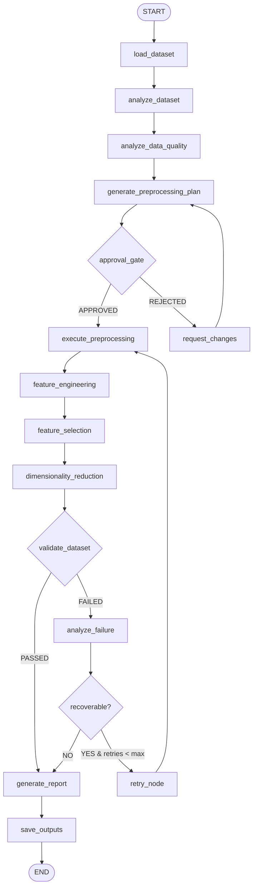
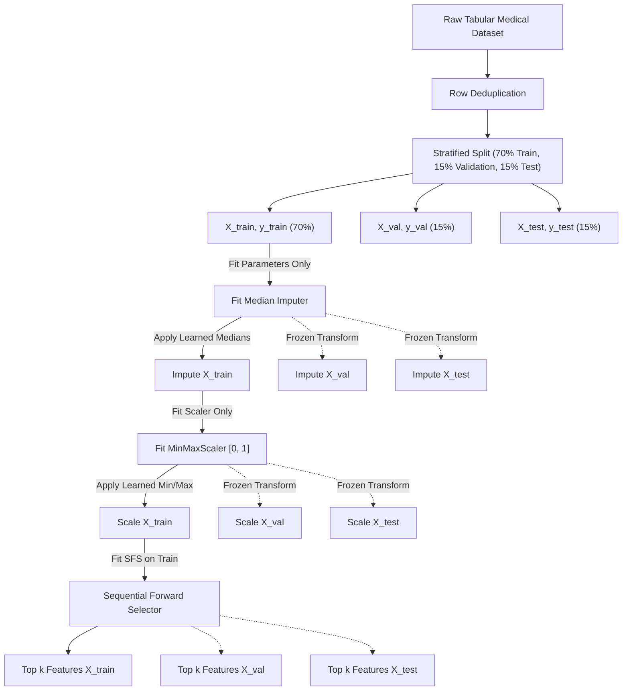

# AI Biomedical Preprocessing Agent — LangGraph Autonomous Engine

An autonomous biomedical data engineering subsystem built with **LangGraph** and **Scikit-learn**, designed to automate tabular clinical dataset inspection, data quality verification, leakage-free transformation, quantum-aligned feature budgeting, and post-processing validation.

---

## Core Architectural Principles

1. **AI Reasoning + Deterministic Tool Decoupling:**
   - **Agent / LLM Role:** Reasoning, schema inspection, data quality diagnosis, workflow planning, parameter tuning, error analysis, and natural-language modification.
   - **Deterministic Python Tools Role:** Concrete DataFrame transformations, statistical calculations, imputer fittings, categorical encodings, outlier clipping, and validations via `scikit-learn` and `pandas`.
   - **Zero Numerical Hallucination:** The LLM never computes, alters, or synthesizes numerical values or distributions directly; every metric is deterministically calculated by mathematical routines.
2. **Strict Data Leakage Prevention ("Split-Before-Fit"):**
   - Imputers, scalers, encoders, and feature selectors are fitted strictly on `X_train`.
   - `X_val` and `X_test` are strictly transformed using frozen parameters learned from `X_train`.
   - A 7-point post-processing validation gate enforces zero target contamination, dimension matching, and finite values.
3. **Quantum Compatibility & Feature Budgeting:**
   - Features are scaled to $[0, 1]$ via `MinMaxScaler`, directly matching quantum angle embedding gates ($R_y(x_i \cdot \pi)$).
   - Explicit feature count budgeting (e.g., target $K=4$) aligns feature sets with physical qubit constraints (4-qubit VQC).
4. **Dual-Engine Operation:**
   - Seamlessly uses LLM reasoning (OpenAI / Gemini / Ollama) when API keys or provider services are active.
   - Gracefully and deterministically falls back to heuristic rule-based planning when offline, in CI/CD, or during automated test runs.

---

## LangGraph Execution Graph

The execution pipeline is orchestrated via a stateful `StateGraph` defined in `app/agent/graph.py`:



---

## Strict Data Leakage Prevention Architecture

In clinical machine learning, computing normalization parameters across the entire dataset prior to splitting leaks test distribution information, producing overly optimistic models that fail on unseen patients. The agent enforces strict mathematical isolation:



---

## Deterministic Tools Suite (`app/tools/`)

The system provides 12 specialized deterministic tools:

| Tool Module | Class / Function | Purpose & Guarantees |
|---|---|---|
| `dataset_loader.py` | `DatasetLoader` | Ingests `.csv`, `.xlsx`, `.parquet`; validates non-empty status and extracts shapes. |
| `dataset_analysis.py`| `analyze_dataset` | Discovers semantic column types (numeric, discrete survey, categorical, ID). |
| `dataset_analysis.py`| `rank_target_candidates` | Heuristic scoring of target columns using keyword matches and cardinality. |
| `quality_analysis.py`| `quality_report` | Audits missingness, duplicate rows, IQR outliers, zero-variance columns, and correlation leakage ($|r| \ge 0.95$). |
| `cleaning.py` | `remove_duplicates` | Drops duplicate rows and resets index. |
| `cleaning.py` | `MissingValueImputer` | Imputes median/mean for numerics and mode for categoricals; strictly fitted on `X_train`. |
| `encoding.py` | `CategoricalEncoder` | Fits `OneHotEncoder` or `OrdinalEncoder` strictly on `X_train`. |
| `encoding.py` | `TargetLabelEncoder` | Enforces binary target mapping (`NO=0`, `YES=1`, `False=0`, `True=1`). |
| `scaling.py` | `NumericalScaler` | Fits `MinMaxScaler(0, 1)` strictly on `X_train` to match quantum rotational angles. |
| `outliers.py` | `OutlierHandler` | Calculates IQR bounds on `X_train` continuous columns, then clips `X_train`, `X_val`, and `X_test`. |
| `feature_selection.py`| `FeatureSelector` | Runs Sequential Forward Selection (SFS) with Logistic Regression to budget top $k$ features for quantum registers. |
| `validation.py` | `validate_processed_dataset` | Enforces 7-point post-processing checklist (zero nulls, all numeric, feature budget match, no test overlap). |

---

## Schema Architecture (`app/schemas/`)

All data exchanges, plans, and reports are governed by Pydantic v2 schemas:
- **`dataset.py`:** `ColumnProfile`, `CandidateTarget`, `DatasetAnalysis`
- **`quality.py`:** `QualityFinding`, `DataQualityReport`
- **`preprocessing.py`:** `PlanOperation`, `PreprocessingPlan`, `TransformationResult`
- **`features.py`:** `FeatureScore`, `FeatureSelectionResult`
- **`validation.py`:** `ValidationErrorItem`, `ValidationResult`
- **`result.py`:** `DatasetSplitResult`, `AgentRunResult`

---

## YAML Configuration Templates (`config/`)

The agent supports configuration via YAML files:
- **`default.yaml`:** General-purpose classification and regression baseline template.
- **`lung_cancer.yaml`:** Specialized benchmark template for the Survey Lung Cancer dataset (enforcing `target: LUNG_CANCER`, `scaling: minmax`, and `target_feature_count: 4`).

---

## Quick Start & Testing

### 1. Installation
```bash
cd ai_preprocessing_agent
python -m venv .venv
# On Windows: .venv\Scripts\Activate.ps1 | On Unix: source .venv/bin/activate
pip install -r requirements.txt
```

### 2. Run Example Pipeline
```bash
python examples/run_agent.py --config config/lung_cancer.yaml
```

Outputs are written to `output/`:
- `processed_dataset.csv`: Cleaned full dataset
- `X_train.csv`, `X_validation.csv`, `X_test.csv`: Transformed feature splits
- `y_train.csv`, `y_validation.csv`, `y_test.csv`: Canonical target splits
- `fitted_pipeline.joblib`: Serialized inference transformer
- `preprocessing_report.json` & `preprocessing_summary.md`: Detailed audit reports

### 3. Run Pytest Suite
```bash
python -m pytest tests/ -v
```
The test suite validates data leakage prevention, imputation isolation, categorical encoding, scaling bounds, and 7-point validation criteria.
